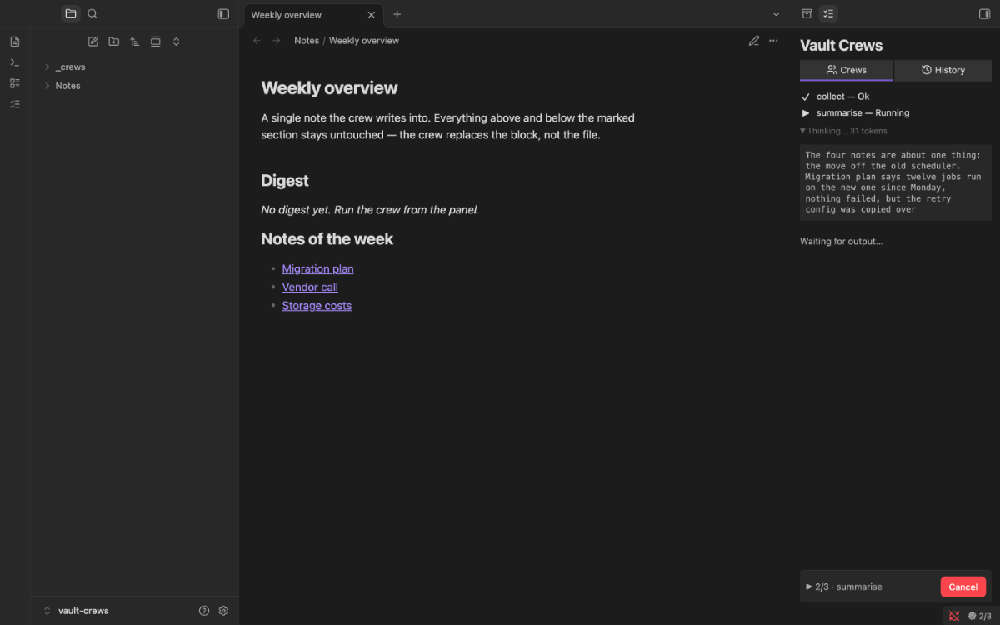
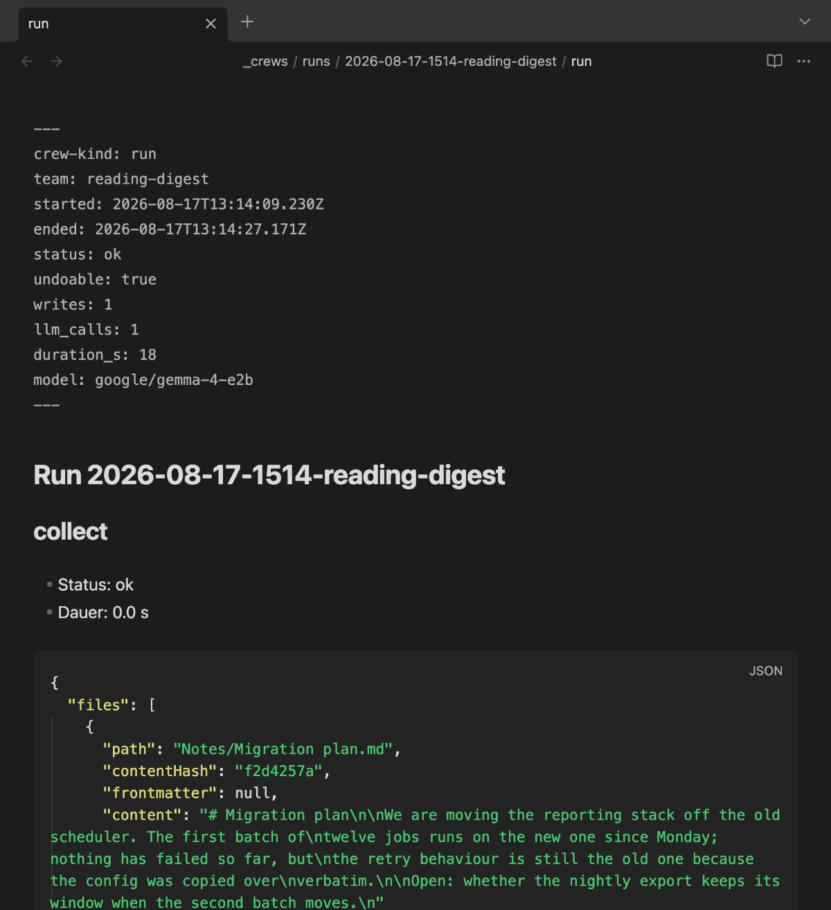
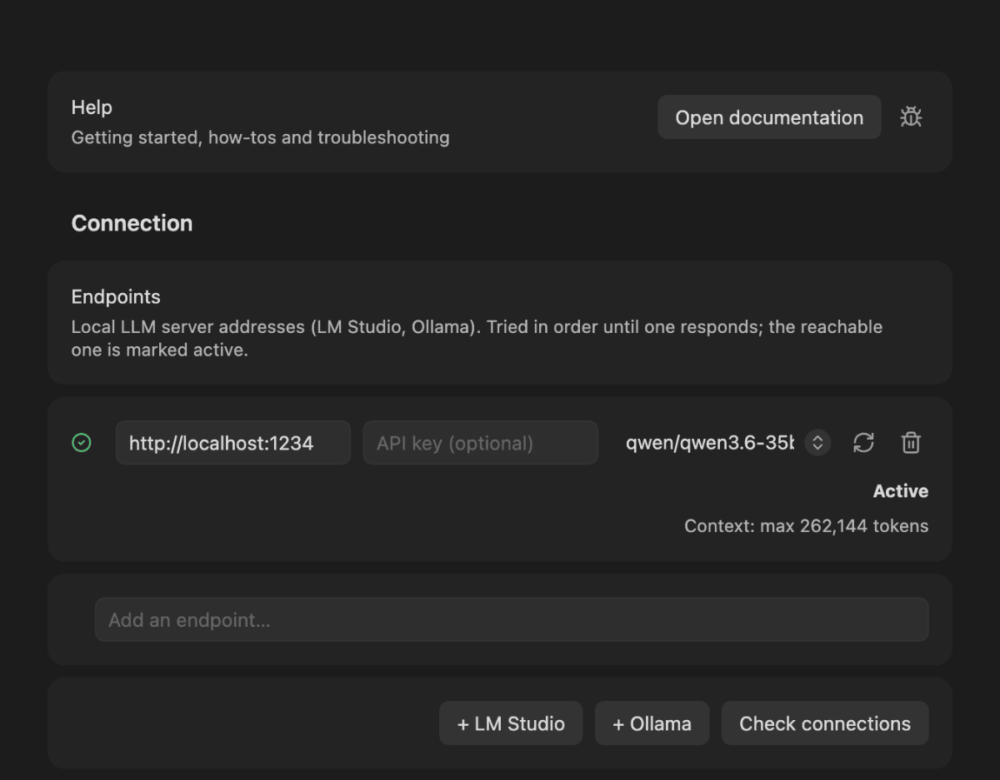
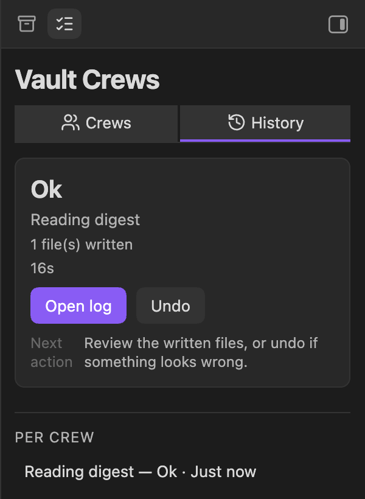
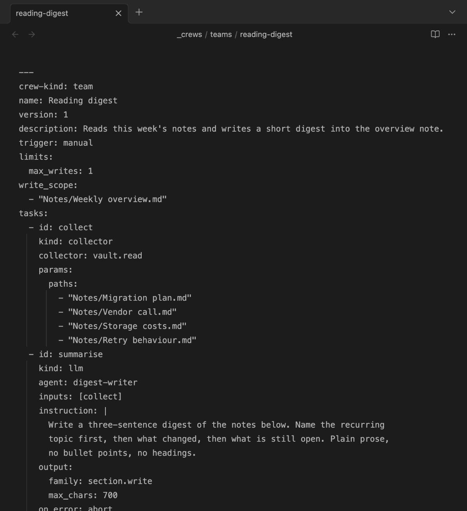

# Vault Crews

Autonome lokale LLM-Agenten-Teams („Crews") auf deinem Obsidian-Vault laufen lassen,
angetrieben von einem lokalen Modell ([LM Studio](https://lmstudio.ai/) oder
[Ollama](https://ollama.ai/)) — mit einer deterministischen, orchestrierten Pipeline und
einem Snapshot-Netz unter jedem Lauf.

Lokale Modelle werden als schwache, unzuverlässige Ausführende behandelt. Der
Orchestrator entscheidet über *Ablauf, Pfade und Schreibvorgänge*; das Modell entscheidet
ausschließlich über *Inhalt*, innerhalb enger, schema-validierter Verträge. Jede Ausgabe
wird eingeschränkt und dann geprüft, bevor sie deinen Vault berührt.

[](https://github.com/johannes-kaindl/vault-crews/blob/main/LICENSE)
[](https://github.com/johannes-kaindl/vault-crews/blob/main/LICENSE-DOCS)
[](https://github.com/johannes-kaindl/vault-crews/releases)
[](https://obsidian.md)

> [🇬🇧 English](https://github.com/johannes-kaindl/vault-crews/blob/main/README.md) · 🇩🇪 Deutsch
>
> Diese Übersetzung folgt der englischen `README.md`. Bei Abweichungen gilt die englische Fassung.

<p align="center"></p>

## Funktionen

- **Deterministische Pipeline, keine freilaufende Agenten-Schleife.** Eine Crew („Team")
  ist eine Folge aus genau drei Aufgabenarten — `collector` (deterministisches Sammeln
  von Kontext), `llm` (eine Chat-Completion gegen einen schema-validierten Vertrag) und
  `actions` (deterministisches Anwenden einer geprüften Aktionsliste auf den Vault). Das
  Modell steuert nie den Ablauf und fasst den Vault nie direkt an.
- **Einschränken, dann prüfen — vor jedem Schreibvorgang.** Jede LLM-Ausgabe wird
  extrahiert, gegen ein eingebautes, versioniertes Schema validiert und an die Quelle
  gebunden — ein Modell kann keinen Dateipfad und keinen Enum-Wert erfinden, den es im
  gesammelten Material nicht schon gab. Ein Reparaturlauf (ein Wiederholungsversuch)
  fängt kaputtes JSON ab.
- **Git-freies Snapshot-Undo, ein Klick.** Bevor ein Lauf eine Notiz anfasst, wird ihr
  Zustand vor dem Lauf per Copy-on-Write in einen versteckten Speicher gesichert (über
  die Vault-/Adapter-API von Obsidian). „Letzten Lauf rückgängig machen" stellt geänderte
  Notizen aus dem Snapshot wieder her und verschiebt im Lauf angelegte Notizen in den
  Papierkorb — kein Git-Repository nötig, funktioniert in jedem Vault.
- **Fünf mitgelieferte Beispiel-Crews**, per Befehl installierbar, in der Sprache der Obsidian-Oberfläche (Deutsch oder Englisch): **Task-Triage** (sichtet Backlog-TaskNotes und schlägt Metadaten-Korrekturen nur auf weichen Feldern vor), **Daily-Briefing** (fasst offene Aufgaben in der heutigen Tagesnotiz zusammen), **Notiz-Tagger** (schlägt Tags für Notizen ohne Tags vor) **Reifegrad-Tagger** (schätzt den Reifegrad einer Notiz aus ihrem Inhalt und schreibt ihn ins Frontmatter) und **Eingangsordner einsortieren** (ergänzt vorhandene Tags an den Notizen eines Eingangsordners und verschiebt jede in einen passenden Ordner). Sie zeigen auf die neutralen Ordner `Aufgaben`, `Tagesnotizen`, `Notizen` und `Inbox` mit den Zielen `Projekte` und `Archiv` (englisch: `Tasks`, `Daily`, `Notes`, `Inbox`, `Projects`, `Archive`); der Text jedes Teams sagt, dass du sie vor dem ersten Lauf anpasst.
- **Volle Nachvollziehbarkeit, im Vault.** Jeder Lauf schreibt eine menschenlesbare
  `run.md` (Frontmatter + Detail je Aufgabe, Bases-kompatibel) und eine
  maschinenlesbare `state.json`, dazu ein mitgeliefertes `runs.base`-Dashboard.
- **Absturz-Wiederaufnahme.** Ein verwaistes Lock zusammen mit einer `state.json`, die
  noch auf `running` steht, wird beim nächsten Laden des Plugins erkannt — mit einer
  empfohlenen Aktion: den Lauf abschließen (die Teiländerungen bleiben, sie sind über
  den Write-Ahead-Snapshot weiterhin rückgängig zu machen).
- Oberfläche auf Englisch und Deutsch.

## Voraussetzungen

- **Nur Desktop** (`isDesktopOnly: true` — das Plugin ist um ein lokal gehostetes,
  über HTTP angesprochenes LLM herum gebaut, und das ist ein Desktop-Ablauf).
- **Ein lokaler LLM-Server:** [LM Studio](https://lmstudio.ai/) (Standard-Port `1234`)
  oder [Ollama](https://ollama.ai/) (Standard-Port `11434`) mit einer
  OpenAI-kompatiblen API. Der Endpunkt ist in den Plugin-Einstellungen konfigurierbar;
  einfach die URL eintragen (z.B. `http://localhost:1234/v1` für LM Studio oder
  `http://localhost:11434/v1` für Ollama). Du kannst mehrere Endpunkte auflisten (einen
  pro Zeile), das Plugin nimmt bei jedem Preflight den ersten erreichbaren. Keine
  Anbieterauswahl nötig — Kontextlänge und Fähigkeiten werden automatisch erkannt.
- **CORS auf deinem LLM-Server aktivieren.** Das Plugin streamt die Modellausgabe per
  `XMLHttpRequest` aus Obsidians Renderer-Prozess (`requestUrl` kann nicht streamen).
  **LM Studio:** Einstellungen → Developer → *Enable CORS*. **Ollama:** die
  Umgebungsvariable `OLLAMA_ORIGINS=<deine-obsidian-app-url>` setzen (optional; ohne sie
  fällt das Plugin auf den nicht-streamenden Modus zurück, Ergebnisse kommen trotzdem
  an).
- **Kein Git-Repository nötig.** Das Undo-Netz ist ein Snapshot je Lauf über die
  Vault-/Adapter-API von Obsidian und funktioniert damit in jedem Vault — Git-Repo oder
  nicht. (Frühere Fassungen setzten ein Git-Repo voraus; seit 0.2.0 ist diese
  Anforderung weg.)


> **Das Live-Token-Streaming braucht CORS auf dem LLM-Server.** Der Ticker läuft als
> `XMLHttpRequest` aus Obsidians Renderer, und der sendet immer `Origin: app://obsidian.md`.
> LM Studio lehnt diesen Preflight ab, solange der Server nicht mit `--cors` gestartet wurde
> (`lms server start --cors`), Ollama, solange `OLLAMA_ORIGINS` es nicht erlaubt. Ohne CORS
> läuft der Lauf trotzdem durch — das Plugin fällt auf eine Non-Streaming-Anfrage über
> Obsidians Hauptprozess zurück —, aber das Panel zeigt bis zum Ende „Warte auf Ausgabe …".

## Installation

Kanonisches Repository: [git.jkaindl.de/jkaindl/vault-crews](https://git.jkaindl.de/jkaindl/vault-crews), gespiegelt auf [GitHub](https://github.com/johannes-kaindl/vault-crews), wo die Releases erscheinen.

### Katalog (empfohlen)

**Über den [AnySource Sideloader](https://github.com/johannes-kaindl/anysource-sideloader)**, der Plugins von jeder Git-Forge installiert und aktualisiert. Den Plugin-Katalog einmal unter **Einstellungen → AnySource Sideloader → Kataloge → Hinzufügen** eintragen:

```
https://git.jkaindl.de/jkaindl/obsidian-catalog/raw/branch/main/catalog.json
```

Vault Crews erscheint dann in der Plugin-Liste des Sideloaders und aktualisiert sich wie jedes andere Plugin; jeder Download wird per Prüfsumme verifiziert. Wer nur dieses eine Plugin ohne Katalog will, trägt stattdessen die Repository-URL als Quelle ein: `https://github.com/johannes-kaindl/vault-crews`.

### Manuell

`main.js`, `manifest.json` und `styles.css` aus dem [letzten Release](https://github.com/johannes-kaindl/vault-crews/releases/latest) nach `<vault>/.obsidian/plugins/vault-crews/` legen und das Plugin unter **Einstellungen → Community-Plugins** aktivieren. Jedes Release liefert zusätzlich `checksums.sha256`, du kannst das Heruntergeladene also mit `shasum -a 256 -c checksums.sha256` prüfen.

```bash
cp main.js manifest.json styles.css "<dein-vault>/.obsidian/plugins/vault-crews/"
```

### Aus dem Quellcode

```bash
git clone https://git.jkaindl.de/jkaindl/vault-crews
cd vault-crews
npm install
npm run build   # erzeugt main.js
```

`main.js`, `manifest.json` und `styles.css` nach `<vault>/.obsidian/plugins/vault-crews/` kopieren.

**Nach dem Aktivieren** (egal auf welchem Weg) den Befehl **„Install example crews"** ausführen, um `_crews/`
(Standard-Wurzel, in den Einstellungen änderbar) mit den fünf Beispiel-Teams (Task-Triage,
Daily-Briefing, Notiz-Tagger, Reifegrad-Tagger, Eingangsordner einsortieren; bei englischer Oberfläche Task triage, Daily briefing, Note tagger, Maturity tagger, Sort inbox), ihren Agenten und dem `runs.base`-Dashboard zu befüllen. Installierte
Dateien werden von einem zweiten Lauf nie überschrieben — bearbeite sie danach frei.

## Verwendung

1. **Deinen lokalen LLM-Server starten** (LM Studio oder Ollama) mit aktiviertem CORS,
   und ein Modell laden. Das Plugin löst bei jedem Preflight den ersten erreichbaren
   Endpunkt auf.
2. **Einmal „Install example crews" ausführen** — das befüllt die Crew-Wurzel
   (standardmäßig `_crews`) mit den fünf Beispiel-Teams, ihren Agenten
   und dem `runs.base`-Dashboard.
3. **Das Crews-Panel öffnen** (Ribbon-Icon oder **Open crews panel**). Es listet die
   gefundenen Teams und zeigt während eines Laufs die aktuelle Aufgabe samt laufender
   Token-Zahlen.
   - Das Panel hat zwei Tabs, **Crews** und **Verlauf**. Anklicken, oder die Tab-Leiste fokussieren und mit den Pfeiltasten Links/Rechts wechseln (Pos1/Ende springen zum ersten/letzten Tab). Während eines Laufs bleibt die Statuszeile mit dem einen **Cancel**-Knopf unten stehen, egal welcher Tab offen ist.
4. **Einen Lauf starten** mit **Run crew…** und der Auswahl eines Teams, oder über den
   team-eigenen Befehl **Run crew: &lt;Name&gt;**, den jedes Team unter seinem eigenen
   Namen registriert.
5. **Beim Arbeiten zusehen.** Das Panel zeigt den Status jeder Aufgabe (wartend,
   laufend, ok, fehlgeschlagen, übersprungen, veraltet). **Abort current run** fordert
   einen Stopp an, der zwischen Aufgaben und innerhalb des Modell-Streams beachtet wird.
6. **Das Protokoll lesen.** Jeder Lauf schreibt eine `run.md` (menschenlesbar,
   Bases-kompatibel) und daneben eine `state.json`; **Open last run log** springt
   dorthin, und `runs.base` listet alle Läufe auf einmal.
7. **Bei Bedarf rückgängig machen.** **Undo last run** zeigt, was es wiederherstellen
   würde (Team, Zeit, Dateien), und fragt vorher nach — geänderte Notizen kommen aus dem
   Snapshot zurück, im Lauf angelegte Notizen wandern in den Papierkorb.

Eigene Teams und Agenten zu schreiben ist schlichtes Markdown im Vault — siehe
[Eigene Crews schreiben](#eigene-crews-schreiben) unten.

## Konfiguration

**Einstellungen → Community-Plugins → Vault Crews**, in vier Gruppen:

| Einstellung | Standard | Bedeutung |
|---|---|---|
| **Endpunkte** | `http://localhost:1234/v1` | Eine Zeile je Endpunkt, jede mit eigener URL, optionalem API-Schlüssel (liegt im Schlüsselbund von Obsidian, nicht in der `data.json`) und eigenem Modell; genutzt wird der erste erreichbare je Lauf. **Check connections** prüft jede Zeile und meldet abgelehnt / unbekannter Host / Zeitüberschreitung / keine LLM-API / Zugriff verweigert getrennt |
| **Gesperrte Endpunkte** | `localhost:8080`, `127.0.0.1:8080` | Werden nie kontaktiert — der Standard hält das Plugin von einem Port fern, den andere lokale Modell-Server üblicherweise belegen. Eine Einstellung, nicht fest verdrahtet |
| **Anfrage** (Request) | (Profil) | Was ein Lauf mit jedem Modellaufruf sendet: Sampling-Werte (temperature, top_p, top_k, …) und die Denkstufe, aus einer Profiltabelle je Modellfamilie und Backend. Eingeklappter Abschnitt; zeigt, was gesendet wird und was davon auf deinem Backend wirkt, nimmt eigene Werte je Modellfamilie an und listet die letzte Anfrage und die Abweichungen dieser Sitzung. Werte in einer Agent-Note gehen für diesen Agenten vor. Die Zeile „Level picker in chat“ hat in Vault Crews keine Wirkung |
| **Crew-Wurzelordner** | `_crews` | Vault-relativer Ordner mit Agenten, Teams und Lauf-Protokollen |
| **Max. Schreibvorgänge pro Lauf** | 10 | Plugin-weite Obergrenze; der `max_writes`-Wert eines Teams kann nur darunter liegen. 0 stoppt das Schreiben aller Crews |
| **Wanduhr-Limit** | 10 Minuten | Bricht einen davonlaufenden Lauf ab; seine Teiländerungen bleiben gesichert und rückgängig zu machen. Mindestens 1 |
| **Tiefe der Undo-Historie** | 15 | Mindestens 1. Wie viele Lauf-Snapshots aufbewahrt werden, bevor die ältesten wegfallen |
| **Zeitlimit je Aufruf** | 300 s | Hartes Limit pro Modellaufruf — großzügig, weil das Laden eines Modells auf Zuruf dauern kann. Mindestens 10 s |
| **Stillstands-Limit** | 60 s | Bricht ab, wenn kein neues Token mehr kommt; wird erst nach dem ersten Token geprüft, damit Laden nie als Stillstand missverstanden wird. Mindestens 5 s |
| **Jeden Modellaufruf mitschneiden** (Record every model call) | aus | Schreibt jeden Modellaufruf eines Laufs (volle Anfrage, Rohantwort, Denken, Dauer, Status; nie Kopfzeilen, API-Schlüssel sind geschwärzt) als eine Zeile nach `<Crew-Wurzel>/runs/<Lauf>/calls.jsonl.gz`, am Lauf-Ende gepackt. Zur Fehlersuche: warum hat das Modell so geantwortet? Lauf-Ordner werden nie aufgeräumt, jeder Lauf legt also eine solche Datei an, und der Mitschnitt kopiert den Text der Notizen, die ans Modell gingen, in deinen Vault; nur zum Suchen einschalten |

Änderungen an Endpunkten und Zeitlimits wirken mit dem nächsten Lauf; ein Neuladen des Plugins ist nicht nötig.






## Funktionsweise

Ein Lauf ist ein **Orchestrator, der eine feste Pipeline abgeht** — kein Modell, das
entscheidet, was als Nächstes kommt. Jedes Team ist eine Folge aus genau drei
Aufgabenarten:

1. **`collector`** — deterministisches Sammeln. Code liest den Vault, nicht das Modell,
   und stellt das Material zusammen (etwa `tasknotes.query` über einen Ordner, optional
   samt Notiz-Inhalt).
2. **`llm`** — genau eine Chat-Completion, die gegen das Schema antwortet, das der
   `output:`-Block der Aufgabe festlegt. Das Modell sieht nur das gesammelte Material
   und erzeugt nur Inhalt — nie einen Pfad, nie eine Ablaufentscheidung.
3. **`actions`** — deterministisches Anwenden. Die geprüfte Aktionsliste wird von Code
   auf den Vault angewendet.

Zwischen Modell und Notizen liegen **zwei unabhängige Prüfungen**. Stufe 1
(`output-validator`) parst die rohe Antwort, validiert sie gegen ein eingebautes,
versioniertes Schema und bindet jeden Pfad und jeden Enum-Wert an das tatsächlich
gesammelte Material zurück — ein vom Modell erfundener Pfad hat nichts, woran er binden
könnte, und wird verworfen. Ein Reparaturversuch fängt kaputtes JSON ab. Stufe 2
(`action-executor`) prüft jede Aktion unmittelbar vor dem Schreiben erneut, unabhängig
von Stufe 1: gegen die `write_scope`-Allowlist und die feste Denylist, gegen die
erlaubten Aktionstypen und Frontmatter-Schlüssel, und gegen einen Inhalts-Hash — hast du
die Datei nach dem Sammeln bearbeitet, wird diese Aktion übersprungen statt deine
Änderung zu überschreiben. Fällt mehr als die Hälfte der Aktionen einer Aufgabe weg,
scheitert die Aufgabe, statt einen halb konsistenten Zustand anzuwenden.

Schreibvorgänge werden **write-ahead** gesichert: der Inhalt einer Notiz vor dem Lauf
wandert über die Vault-/Adapter-API von Obsidian in einen versteckten Speicher je Lauf,
bevor sie angefasst wird. Deshalb bleibt selbst ein abgestürzter oder abgebrochener Lauf
vollständig rückgängig zu machen, und deshalb braucht es kein Git-Repository.



## Sicherheitsmodell

- **`write_scope`-Allowlist je Team, plus eine feste Denylist, die immer gewinnt.** Jedes
  Team erklärt die vault-relativen Globs, in die es schreiben darf. Eine feste Denylist —
  `.obsidian/**`, `.git/**`, `_crews/**`, `_vaultrag/**`, Dotfiles — sticht jede
  Allowlist bedingungslos; Crews können ihre eigene Konfiguration nie lesen oder
  schreiben (kein Selbstauslösen, kein Prompt-Injection-Pfad in die Plugin-Steuerung).
- **Ein Snapshot unter jedem Schreibvorgang — Undo mit einem Klick.** Vor dem Schreiben
  jeder Notiz wird ihr Inhalt vor dem Lauf write-ahead in einen versteckten Speicher je
  Lauf gesichert (unter `.obsidian/plugins/vault-crews/undo/`). Selbst ein
  fehlgeschlagener oder abgebrochener Lauf mit Teiländerungen bleibt vollständig
  rückgängig zu machen. **Undo last run** stellt geänderte Notizen wieder her und
  verschiebt im Lauf angelegte in den Papierkorb; es zeigt vor der Bestätigung genau,
  was es rückgängig macht (Team, Zeit, Dateien) — und warnt, wenn eine Notiz nach dem
  Lauf bearbeitet wurde, statt sie stillschweigend zu überschreiben. Im Lauf angelegte
  Notizen gehen in Obsidians Papierkorb, nie in ein hartes Löschen.
- **Schreib- und Zeitgrenzen.** `max_writes` pro Lauf (je Team konfigurierbar, gedeckelt
  durch eine plugin-weite Obergrenze), eine harte Größengrenze je Notiz, ein Budget für
  LLM-Aufrufe und ein Wanduhr-Wächter (Standard 10 Minuten), der einen davonlaufenden
  Lauf abbricht (seine Teiländerungen bleiben gesichert und rückgängig zu machen), statt
  ewig weiterzulaufen.
- **Konsistenz-Schwelle.** Werden mehr als 50 % der vorgeschlagenen Aktionen einer
  Aufgabe verworfen oder sind sie veraltet, scheitert die ganze Aufgabe, statt einen
  semantisch inkonsistenten Teilzustand anzuwenden; unterhalb dieser Schwelle werden
  einzelne Aktionen übersprungen und protokolliert.
- **Einschränken und prüfen, zweimal.** Stufe 1 (`output-validator`) validiert das rohe
  Modell-JSON gegen ein eingebautes Schema und bindet jeden Pfad und Enum-Wert an das
  Material, das für diese Aufgabe tatsächlich gesammelt wurde. Stufe 2
  (`action-executor`) prüft jede Aktion erneut gegen Pfad-Allowlist/-Denylist, erlaubte
  Aktionstypen, erlaubte Frontmatter-Schlüssel und einen Inhalts-Hash gegen Veralten
  (hast du die Datei seit dem Sammeln bearbeitet, wird genau diese Aktion übersprungen,
  nie still überschrieben) — unmittelbar vor dem Schreiben, unabhängig von Stufe 1.

## Netzwerk-Offenlegung

- Das Plugin spricht mit genau einem Netzwerk-Endpunkt: deinem lokalen LLM-Server
  (standardmäßig LM Studio `http://localhost:1234/v1` oder Ollama
  `http://localhost:11434/v1`, vom Nutzer konfigurierbar). Kein anderer Host wird je
  kontaktiert, keine Telemetrie, keine Analytics, keine Update-Pings.
- **API-Schlüssel liegen im Schlüsselbund von Obsidian**, nicht in deinem Vault: die `data.json` behält nur einen Verweis, ein synchronisierter Vault trägt sie also nicht mit. Ein Schlüssel, den du vor 0.14.0 eingetragen hast, zieht um, sobald das Plugin seine Endpunkte das nächste Mal auflöst.
- **Geheimnisse in deinen Notizen werden maskiert, bevor ein Modell sie sieht.** Private Schlüssel (PEM-Blöcke), `Bearer`-Tokens und gängige API-Schlüssel-Formate (`sk-…`, `ghp_…`, …) im Text, den eine Crew sendet, werden zu Platzhaltern wie `[redacted-token-1]`; die Antwort bekommt vor dem Schreiben das Original zurück. Notizen erreichen das Modell als JSON-Text, ein wiederhergestellter PEM-Block behält seine Zeilenumbrüche daher als `\n`. E-Mail-Adressen und andere personenbezogene Daten werden **nicht** maskiert.
- Port 8080 steht standardmäßig auf der Denylist (üblicherweise von anderen lokalen
  Einzelnutzer-Modellservern belegt) — das ist eine *Einstellung* mit diesem Standard,
  kein fest verdrahtetes Verhalten, und lässt sich ändern.
- Keine Shell-Ausführung und kein direkter Dateisystemzugriff: das Undo-Netz schreibt
  seine Snapshots ausschließlich über die Vault-/Adapter-API von Obsidian, nie über
  `child_process` oder `node:fs`.

## V1-Einschränkungen

Dokumentiert, statt stillschweigend zu fehlen:

- **Kein Transport-Retry und kein erneutes Auflösen des Endpunkts mitten im Lauf.**
  Stirbt LM Studio oder bricht die Verbindung während des Streams ab, scheitert der
  aktuelle Aufruf und der Lauf endet als `failed`, mit gesicherten Teiländerungen; das
  Plugin versucht innerhalb eines Laufs weder neu zu verbinden noch den Endpunkt neu
  aufzulösen. Das ist bewusst aufgeschoben — ein gescheiterter Lauf ist immer sicher
  (Undo-Snapshot + vollständiges Protokoll) und billig zu wiederholen: `section.replace`
  ist idempotent, und `note.create`/Patch-Semantik verweigern eine doppelte Anwendung.
  Dieselbe Crew nach einem Neustart von LM Studio einfach erneut laufen zu lassen ist
  der vorgesehene Weg.
- **Die Absturz-Wiederaufnahme setzt ein einzelnes Gerät voraus.** Die Erkennung
  verwaister Läufe (altes Lock + `state.json` noch auf `running`) ist für „Obsidian ist
  auf diesem Rechner mitten im Lauf abgestürzt" gebaut. Ein Vault, der über zwei
  gleichzeitig laufende Obsidian-Desktops synchronisiert wird (etwa per iCloud/Syncthing,
  während beide offen sind), ist für V1 ausdrücklich außerhalb des Umfangs — siehe
  Entwurfsrisiko #8.
- **Rohe LLM-Ausgabe bei Validierungsfehlern landet unter `runs/<id>/artifacts/`.**
  Scheitert die Ausgabe einer Aufgabe an Schema- oder Quellbindungs-Validierung, wird die
  rohe Modellantwort nach `artifacts/<taskId>-1.txt` geschrieben; scheitert auch der eine
  Reparaturversuch, kommt dessen Antwort nach `artifacts/<taskId>-2.txt`. Das speist den
  Test-Fixture-Bestand echter kaputter Modellausgaben und wird unterhalb des
  Lauf-Verzeichnisses geschrieben — es zählt nie als Vault-Schreibvorgang, rührt
  `max_writes` nicht an und wird nicht für das Undo gesichert. Erfolgreiche Läufe
  schreiben gar keine Artefakte.
- **Der Rohtext eines erfolgreichen Aufrufs steht nur mit dem Mitschnitt im Lauf-Ordner.** Ohne die Einstellung „Jeden Modellaufruf mitschneiden“ schreibt ein Lauf Rohantworten nur bei ungültiger Antwort oder Reparatur nach `artifacts/`. Mit ihr steht jede Anfrage und Antwort in `calls.jsonl.gz`; Bilder kommen im Mitschnitt nicht vor, weil kein Collector welche liest.
- **Das Fehlerprotokoll öffnet `run.md` oben, nicht bei der gescheiterten Aufgabe.**
  „View failure" öffnet die Protokolldatei des Laufs über
  `workspace.getLeaf().openFile()` ohne flüchtigen Scroll-Zustand — du landest oben in
  der Notiz und scrollst selbst zum passenden `##`-Abschnitt.
- **Ein Lauf lässt sich nur kooperativ abbrechen — und das Panel sagt das ehrlich.**
  „Cancel" / „Abort current run" setzt das Abbruch-Flag, das zwischen Aufgaben und
  innerhalb des LLM-Streams beachtet wird; greift es, bekommst du `status: aborted` mit
  Teiländerungen (rückgängig zu machen). Mit einem schnellen lokalen Modell kann ein
  ganzer Lauf in 1–2 s fertig sein, ein Klick also nach dem letzten Prüfpunkt landen und
  der Lauf normal enden — das ist *richtig so* (die Arbeit war schon getan), kein
  verlorener Klick. Das Panel bildet das wahrheitsgemäß ab: während des Abbruchs zeigt es
  „Abort requested…", und war der Lauf vorher fertig, sagt es „der Lauf war vor dem
  Abbruch fertig — es wurde nichts abgebrochen", statt in einem Spinner zu erstarren.
  Einen Mechanismus, bereits fertige Arbeit wegzuwerfen, gibt es bewusst nicht.



## Eigene Crews schreiben

Eine Crew ist Markdown im Vault: ein **Team** (`crew-kind: team`) als Pipeline aus
`collector → llm → actions`, plus **Agent**-Notes (`crew-kind: agent`, System-Prompt
im Body). Die mitgelieferten Crews (Command „Install example crews") sind editierbare
Beispiele — kopiere und passe sie an.

### Modell-Einstellungen eines Agenten (`temperature`, `seed`, `max_tokens`, `thinking`)

Eine Agent-Note kann im Frontmatter vier Modellwerte setzen; alle sind optional und gehen für diesen Agenten den **Anfrage**-Einstellungen des Plugins vor.

`temperature` ist eine Zahl von 0 bis 2 und wird wie angegeben gesendet; ohne sie gilt der Profilwert der Modellfamilie (0,1 für Crews). Ein Wert anderen Typs oder außerhalb der Spanne (`temperature: "0.2"`) ist wie bei `seed` ein Fehler in der Agent-Note, mit Feldnamen. `seed` ist eine ganze Zahl ab 0 (alles andere ist ein Fehler in der Agent-Note); er wird im Lauf-Log gezeigt (`- Seed: 42`), aber das Plugin sendet ihn nur dort, wo das Backend ihn annimmt (heute Open WebUI, laut Profil-Tabelle des Kits): LM Studio ignoriert ihn (vom Kit gemessen) und bekommt ihn deshalb nicht, die übrigen Backends sind nicht gemessen und bekommen ihn auch nicht. Das Lauf-Log vermerkt dann „nicht gesendet“, ein Seed ist dort also kein Versprechen für wiederholbare Antworten. Das gilt ebenso für einen Seed aus den **Anfrage**-Einstellungen. `max_tokens` ist das Token-Budget des Agenten, eine ganze Zahl ab 1 (Standard 2048; alles andere ist ein Fehler in der Agent-Note); eine Denkstufe kann es auf die Reserve der Modellfamilie anheben, damit das Denken nicht das ganze Budget aufbraucht. `thinking` ist `off`, `on` oder `auto` (Standard): `off` bittet das Modell, nicht zu denken, `on` bestellt die Stufe `medium`, `auto` folgt den **Anfrage**-Einstellungen, deren Standard „aus“ ist.

Das Panel zeigt, welches Modell und welche Denkstufe jeder Agent einer Crew bekommt: unter einer Crew im Tab **Crews** den Aufklapper **Modelle** öffnen. Die Anzeige ist nur lesend. Ein `model:` in der Agent-Note steht dort als Wunsch: er gilt nur, wenn der aktive Endpunkt dieses Modell führt, sonst gilt das Modell der Endpunkt-Zeile, das daneben steht. Das Panel fragt den Endpunkt nie, kann also vor dem Start nicht sagen, welches von beiden gilt. **Rückfall-Modell in den Einstellungen ändern** öffnet die Einstellungen des Plugins, in denen das Modell der Endpunkt-Zeile steht. Hat eine Crew schon gelaufen, nennt der Aufklapper zusätzlich je Agent das Modell des letzten Laufs (**Zuletzt benutzt: …**), und man sieht, welches von beiden galt; vor dem ersten Lauf fehlt diese Zeile.

### Output-Vokabular (`output:`)

Ein `llm`-Task legt sein Ausgabeformat über einen `output:`-Block fest:

- **`frontmatter.set`** — das Modell schlägt Frontmatter-Werte für Quell-Notizen vor.
  `allowed_keys` beschränkt, welche Felder gesetzt werden dürfen. Pfade sind an das
  Quellmaterial gebunden (keine Halluzination); die strukturelle Enum-Erzwingung
  bindet Werte an die im Vault vorhandenen Ist-Werte, greift aber erst, wenn das Feld
  im Ordner bereits belegte Werte hat — beim allerersten Lauf (noch keine Werte, keine
  Wertetabelle) kommt eine Wertebeschränkung nur aus Instruktion und Agent-Prompt.
  ```yaml
  output:
    family: frontmatter.set
    allowed_keys: [tags, kategorie]
  ```
  Mit `values` gibst du einem Feld eine Wertemenge, mit `add_to` nennst du die Felder, deren Wert zur vorhandenen Liste der Notiz hinzukommt, statt sie zu ersetzen (die Vereinigung ohne Doppelte, gebildet beim Schreiben der Notiz; ohne `add_to` ersetzt der Wert wie bisher). Eine Menge kommt aus `list` (feste Werte), `from: tags` (die Tags des Vaults, ohne `#` geschrieben) oder `from: notes` mit einem `folder` (die Notizen dieses Ordners samt Unterordnern, geschrieben als `[[Name]]`). Das Modell sieht je Wert eine Kurzform, geschrieben wird das Original. Ein Wert ohne brauchbare Kurzform oder mit gleicher Kurzform wie ein anderer steht in `run.md`. Höchstens 300 Werte je Feld: bei Tags die häufigsten, bei Notizen die zuletzt geänderten, und `run.md` nennt die Kürzung. Ein Schlüssel unter `values`, der nicht in `allowed_keys` steht, macht die Crew ungültig. Ein Tag, den es im Vault nicht gibt, wird abgelehnt. `add_to` vergleicht exakt, ohne Normalisierung: `tags: "a, b"` als ein Text wird EIN Element, nicht zwei Tags.
  ```yaml
  output:
    family: frontmatter.set
    allowed_keys: [type, tags, projekt]
    values:
      type: { list: [Protokoll, Rechnung, Notiz] }
      tags: { from: tags }
      projekt: { from: notes, folder: Projekte }
    add_to: [tags]
  ```
- **`section.write`** — das Modell schreibt Markdown-Text, der per `section.replace`
  in das `target` des nachgelagerten `actions`-Tasks geschrieben wird. Optional
  `max_chars` (Default 16000).
  ```yaml
  output:
    family: section.write
  ```
- **`text.append`** — das Modell schreibt Markdown-Text, den `note.append` ans Ende des `target` des nachgelagerten `actions`-Tasks hängt, auf Wunsch unter der Überschrift `heading` (die Überschrift muss in der Notiz schon stehen). Optional `max_chars` (Default 4000, höchstens 16000). Anhängen ist nicht wiederholbar: ein zweiter Lauf hängt erneut an. `heading` steht ohne `#` (`Log`, nicht `## Log`).
  ```yaml
  output:
    family: text.append
    heading: Log
  ```
- **`notes.create`** — das Modell schlägt neue Notizen als `{"items": [{"title": "…", "body": "…"}]}` vor; nur Titel und Text kommen vom Modell. Der Ordner, die Frontmatter-Felder jeder neuen Notiz und das Feld für den Link auf die bearbeitete Notiz stehen fest in der Crew-Datei. Der Pfad ist `folder`, dann der Titel durch die Namensrichtlinie, dann `.md`; der Titel hat höchstens 120 Zeichen und braucht mindestens einen Buchstaben oder eine Ziffer. `folder` darf `{{today}}` enthalten. Den Inhalt baut das Frontmatter-Modul der Bibliothek, nicht eine Textverkettung. `max_items` ist standardmäßig 5, höchstens 50, mehr Einträge sind ein Schemafehler. `link_source` nennt das Frontmatter-Feld, das einen Link auf die bearbeitete Notiz bekommt, und verlangt `per_note: true`; der Link steht als Pfadlink (`[[Inbox/Notiz]]`). Der `actions`-Task braucht `note.create` in `allowed_actions`. Vorhandene Notizen werden nie überschrieben: die Aktion wird mit „existiert bereits“ abgelehnt, ebenso derselbe Titel zweimal in einem Lauf. Diese Ablehnungen zählen nicht für die Konsistenz-Schwelle, ein wiederholter Lauf mit gleichen Titeln endet also als `partial`, nicht als `failed`. `notes.create` sagt keine Wiederholbarkeit zu: liefert das Modell im zweiten Lauf andere Titel, entstehen weitere Notizen.
  ```yaml
  output:
    family: notes.create
    folder: Aufgaben
    max_items: 10
    frontmatter: { type: Aufgabe, status: backlog, tags: [aus-crew] }
    link_source: quelle
  ```
  Werte in `frontmatter` sind einzeilige Texte, Zahlen, `true`/`false` (als YAML-Wahrheitswert geschrieben, ein Bases-Filter auf eine Checkbox findet sie) oder Listen einzeiliger Texte, und ein `folder` mit `{{today}}` wird mit dem Datum 2000-01-01 gegen `write_scope` geprüft: der Bereich braucht ein Muster wie `Journal/**` oder `Journal/20*/**`, nicht einen einzelnen Tag.
- **`note.file`** — das Modell legt Notizen ab: `{"items": [{"path": "…", "to": "…"}]}`. `path` ist an das Quellmaterial gebunden, `to` muss ein Ordner aus der Liste oder `none` sein. `none` und der Ordner, in dem die Notiz schon liegt, erzeugen keine Aktion. Die Liste besteht aus `destinations` (feste Ordner mit optionaler Beschreibung `when`) und/oder `destinations_from` (die direkten Unterordner eines Ordners, höchstens 100, ohne Beschreibung); mindestens eines von beiden ist Pflicht. Ein Unterordner außerhalb von `write_scope`, auf der Sperrliste oder mit dem Namen `none` fällt weg, und `run.md` sagt es. Der `actions`-Task braucht `note.move` in `allowed_actions`, es gibt höchstens einen solchen Task je Crew, und er muss der letzte Task sein. Quelle und Zielordner müssen in `write_scope` liegen; der Zielordner muss schon existieren, die Crew legt nie einen Ordner an, und ein belegter Zielpfad wird abgelehnt. Das Verschieben läuft über den Dateimanager von Obsidian, der Links in anderen Notizen so nachzieht, wie du es in den Obsidian-Einstellungen gewählt hast. **Verschieben verlangt, dass diese Einstellung eingeschaltet ist** (Einstellungen → Dateien und Links → „Interne Links automatisch aktualisieren“; sie ist in Obsidian **standardmäßig aus**, schalte sie für Crews mit `note.move` ein): ist sie aus, fragt Obsidian mitten im Lauf per Dialog, und der Lauf wartete auf einen Klick; eine Crew mit `note.move` in `allowed_actions` startet deshalb nicht (der Lauf wird mit Begründung verweigert, bevor etwas gesperrt oder geschrieben wird). **Das ändert Notizen außerhalb von `write_scope`:** die Grenze gilt für die verschobene Notiz, nicht für die Verweise auf sie. **Rückgängig** schiebt die Notiz zurück (und die Links erneut); liegt die Notiz nicht mehr am neuen Pfad oder ist der alte Pfad wieder belegt, bleibt sie unberührt und wird als Konflikt gemeldet. Lässt sich eine solche Notiz gar nicht wiederherstellen (sie ist weg, oder ihr alter Pfad ist belegt), bietet ein zweiter Dialog an, den Lauf zu verwerfen; sonst bleibt der Lauf rückgängig-fähig, bis sein Snapshot ausläuft.
  ```yaml
  output:
    family: note.file
    destinations:
      - { folder: Projekte/Meyer, when: "Alles zum Kunden Meyer" }
      - { folder: Archiv/Rechnungen, when: "Rechnungen und Belege" }
    destinations_from: Projekte
  ```

Mit `per_note: true` am `llm`-Task läuft der Modellaufruf einmal je Notiz, und das `target` des nachgelagerten `actions`-Tasks darf `{{input}}` sein: es steht für den Pfad der Notiz, um die es im jeweiligen Aufruf geht, jede Notiz bekommt also ihren eigenen Abschnitt oder Text. `{{input}}` ohne `per_note: true` ist ein Definitionsfehler.

**Ein Modellaufruf je Notiz (`per_note`).** Mit `per_note: true` läuft der `llm`-Task einmal je Notiz seiner Eingaben, nacheinander, und jeder Aufruf sieht nur diese Notiz. Die Aktionen aller Aufrufe bilden zusammen das Ergebnis des Tasks. Höchstens 20 Notizen je Task: der Rest wird übersprungen, `run.md` nennt ihn, und der Lauf endet als `partial`. `on_error: skip` überspringt die eine Notiz und macht weiter, `on_error: abort` bricht den Lauf ab. Eine Notiz, die nur gekürzt gelesen wurde (der Collector kappt eine Notiz bei 32 768 Zeichen und alle Notizen zusammen bei 262 144), steht in `run.md` als „gekürzt gelesen“; eine Notiz, die allein nicht in den Kontext des Modells passt, zählt als Fehler dieses Aufrufs. Die Wanduhr gilt wie bisher: läuft sie mitten in einem solchen Task ab, endet der Lauf als `failed`, und die Meldung nennt die Einstellung. **`max_writes` zählt Notizen**, nicht Aktionen: jede geänderte, angelegte oder verschobene Notiz zählt einmal je Lauf, eine Notiz, die Tags bekommt und dann verschoben wird, also einmal. Für Stapel über dem Standard von 10 hebst du zuerst die Plugin-Einstellung „Max. Schreibvorgänge pro Lauf“ und danach `max_writes` in der Crew-Datei, sonst scheitert der Aktions-Task mit `write_limit`. **Setze `per_note: true` bei großen Stapeln:** ohne es stehen Notizen jenseits der Gesamtgrenze von 262 144 Zeichen ohne Inhalt (`[gekürzt]`) im Material, bleiben aber schreibbar, das Modell kann also an eine Notiz schreiben oder sie verschieben, deren Text es nie gesehen hat.

**Mehrere Schritte auf derselben Notiz.** Der Lauf merkt sich für jeden Pfad den Stand, den er zuletzt selbst geschrieben hat. Der Veraltet-Schutz lässt eine Notiz gelten, deren aktueller Stand entweder der Stand beim Einsammeln oder dieser letzte eigene Stand ist; eine Crew kann also erst Frontmatter setzen und danach einen Abschnitt an derselben Notiz schreiben. Jede andere Änderung (du tippst während des Laufs in der Notiz) bleibt „stale“.

### Was die Familien nicht zusagen

- Ein Schritt darf nicht auf die Wirkung eines früheren Schritts desselben Laufs bauen: Anhängen an eine Notiz, die derselbe Lauf erst anlegt, wird nicht unterstützt. Die Schreibschritte prüfen gegen den Vault, wie er vor dem Lauf war; mehrere Schritte auf eine vorhandene Notiz sind in Ordnung.
- Freier Text aus dem Modell (der Inhalt neuer Notizen, Abschnitte, angehängter Text) kann Unerwünschtes enthalten, etwa einen Link, wenn eine gelesene Notiz das Modell dorthin geführt hat. Alles andere, was das Modell wählt, ist strukturell gebunden: Pfade kommen aus dem Quellmaterial, Ordner aus der Crew-Datei, Ziele aus einer Liste, Werte aus einer Wertemenge. Prüfe das Ergebnis in `run.md` und nutze Rückgängig.
- Zwei `actions`-Tasks dürfen nicht dasselbe `target` haben, wenn beide `section.replace` erlauben (auch nicht zweimal `{{input}}`).
- Crews, die `note.create`, `note.append` oder `note.move` erlauben, müssen in diesem Release `review: false` angeben (siehe unten). **Das gilt auch für handgeschriebene Crews aus 0.26, die `note.create` oder `note.append` erlauben:** 0.26 nahm sie ohne das Feld an, jetzt werden sie als `crew_invalid` abgelehnt, bis `review: false` ergänzt ist; die mitgelieferten Crews sind nicht betroffen.

### Vorschau (`review`)

`review: false` ist in der Team-Datei Pflicht, sobald eine Crew Notizen anlegen, anhängen oder verschieben kann. `review: true` wird mit „Vorschau kommt mit dem nächsten Release“ abgelehnt: die Vorschau vor dem Schreiben (der wartende Lauf) ist noch nicht gebaut, eine Crew schreibt sofort, und du prüfst das Ergebnis in `run.md` und nutzt Rückgängig. Das Feld ist schon jetzt Pflicht, damit der spätere Standard (`true` für schreibende Crews) keine Crew still ändert, die in der Zwischenzeit geschrieben wird.

Die älteren Namen `output_schema: triage-v1` / `briefing-v1` bleiben als Kurzform gültig.

### Inhalt lesen (`include_content`)

Standardmäßig liefert `tasknotes.query` nur Frontmatter. Für Crews, die den
Notiz-**Text** brauchen (Tagger, Zusammenfasser), setze `include_content: true`:

```yaml
collector: tasknotes.query
params:
  folder: Notizen
  where_missing: [tags]
  include_content: true
```

### Schreib-Sicherheit (`write_scope`)

`write_scope` ist eine Glob-Allowlist: eine Crew darf nur dort schreiben. Setze sie
so eng wie möglich — und lass `collector`-`folder` und `write_scope` auf denselben
Ordner zeigen, sonst werden Vorschläge außerhalb der Schreibfreigabe verworfen. Das
Plugin-Limit „Max. Schreibvorgänge pro Lauf" deckelt zusätzlich jeden `max_writes`-Wert.

### Wiederkehrende Läufe (`trigger: interval`)

Ein Team mit `trigger: interval` und `interval: 30m` (Einheiten `m`, `h`, `d`; mindestens `5m`) startet von selbst, solange Obsidian offen ist. Der erste Lauf kommt ein Intervall nach dem Laden des Plugins, nie beim Start. Ein fälliger Lauf geht durch dieselbe Ein-Lauf-Sperre wie ein Klick: ist gerade ein Lauf aktiv, fällt dieser Takt still aus und das nächste Intervall zählt von dort. Nach geschlossenem Obsidian wird nichts nachgeholt. Alles, was einen manuellen Lauf schützt, gilt weiter: Schema-Prüfung, `write_scope`, Schreibgrenze und Undo-Schnappschuss.

## Dokumentation

- [Dokumentations-Index](https://github.com/johannes-kaindl/vault-crews/blob/main/docs/README.md) — alle Anleitungen an einem Ort (englisch).
- [Getting started](https://github.com/johannes-kaindl/vault-crews/blob/main/docs/getting-started.md) — von der Installation bis zum ersten Crew-Lauf und seinem Undo (englisch).
- [Troubleshooting](https://github.com/johannes-kaindl/vault-crews/blob/main/docs/troubleshooting.md) — die genaue Meldung, ihre Ursache und die Abhilfe (englisch).

## Lizenz

Code: AGPL-3.0-or-later ([`LICENSE`](https://github.com/johannes-kaindl/vault-crews/blob/main/LICENSE)), Dokumentation: CC BY-SA 4.0 ([`LICENSE-DOCS`](https://github.com/johannes-kaindl/vault-crews/blob/main/LICENSE-DOCS)). Eine kommerzielle Lizenz gibt es auf Anfrage — siehe [`LICENSING.md`](https://github.com/johannes-kaindl/vault-crews/blob/main/LICENSING.md).
